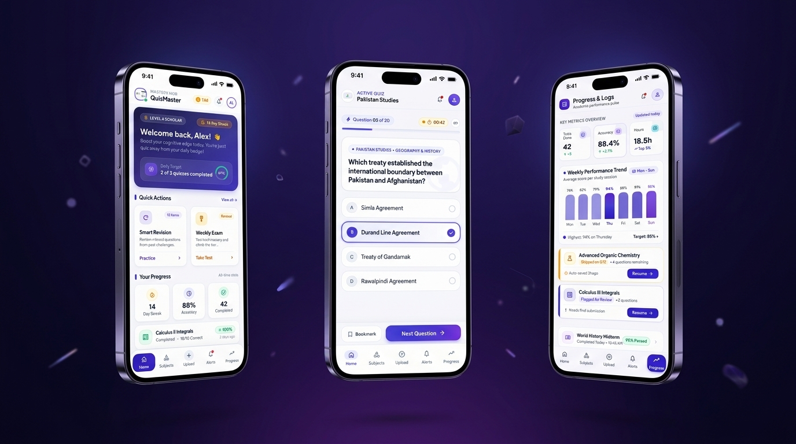

# QuizMaster

An offline-first Flutter quiz application that turns personal question banks into focused practice sessions and makes learning progress easier to review.

> Source code is private. Demo and project details are provided for portfolio and evaluation purposes.

## Project Overview

QuizMaster is a mobile learning experience for organizing subject-based questions, practicing in short quiz sessions, and reviewing performance over time. The interface brings question import, practice, and progress tracking together in one cohesive app.

*Illustrative product render for portfolio presentation; this is not a direct capture of the running application.*

## Features

- Timed daily and weekly quiz sessions, with revision practice
- Import question banks from Excel spreadsheets and assign them to subjects
- Organize subjects and adjust their practice weighting
- Review quiz results, skipped questions, and historical performance
- View progress summaries and weekly trends
- Schedule daily and weekly practice reminders
- Keep quiz data available locally on the device

## Screenshots

Screenshots will be added in a future update.

## Tech Stack

- Flutter and Dart
- Provider for application state management
- SQLite for on-device data storage
- Excel parsing and file selection for question-bank import
- Local notifications for practice reminders

## Architecture Overview

The application is organized around a Flutter presentation layer for the main learning flows, an application state layer, and local data and service capabilities. Data import and notification scheduling support the user-facing flows without exposing implementation internals in this portfolio.

## Challenges Solved

- Making spreadsheet-based question collections usable as structured practice material
- Supporting repeatable practice and revision without a sign-in or network dependency
- Turning individual quiz sessions into clear progress and review views

## Development Highlights

- A consistent, purpose-built visual language across the learning flows
- A local-first experience that keeps the core practice journey self-contained
- Focused separation between presentation, application state, and supporting services

## My Contributions

Project design and Flutter implementation, including the quiz experience, subject management, spreadsheet import flow, local data handling, progress views, and practice reminders.

## Demo

No public demo video is currently available. A walkthrough can be shared on request.

## Contact

- **Ali Asghar Madni** — [GitHub](https://github.com/AliAsgharMadni)
- **Email** — [aliasghar7406@gmail.com](mailto:aliasghar7406@gmail.com)
